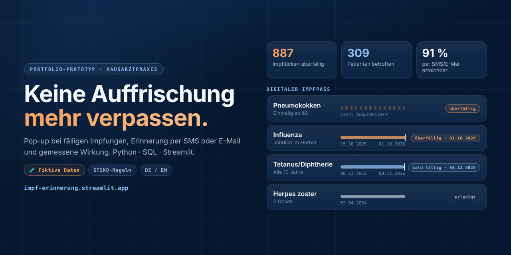
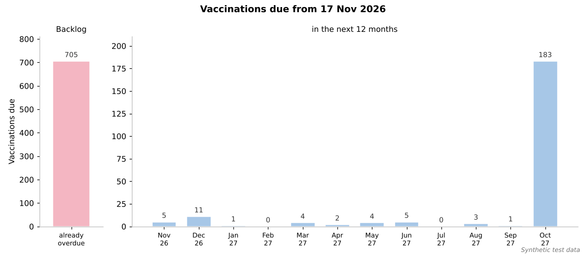
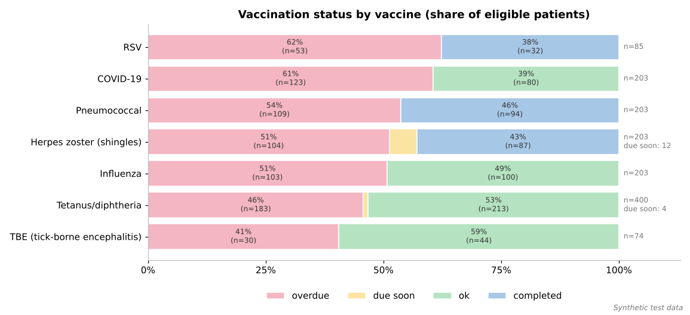
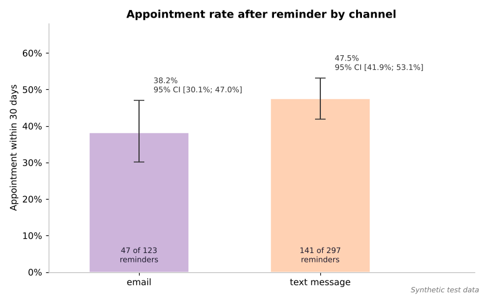
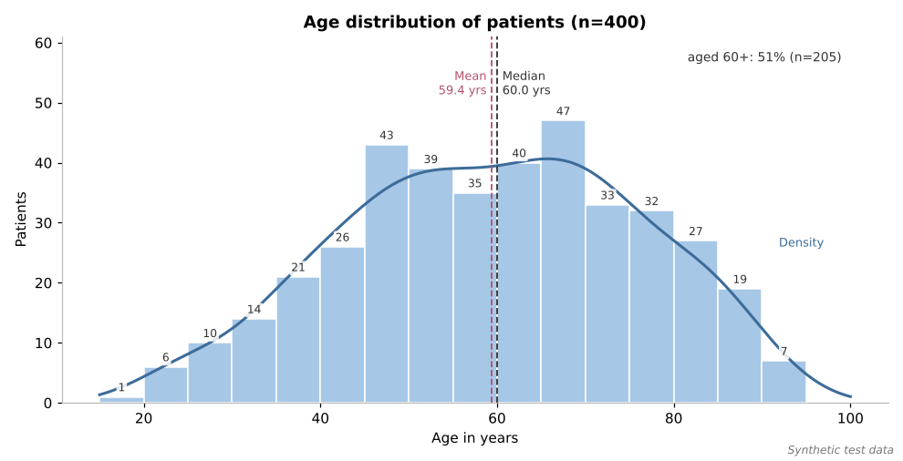
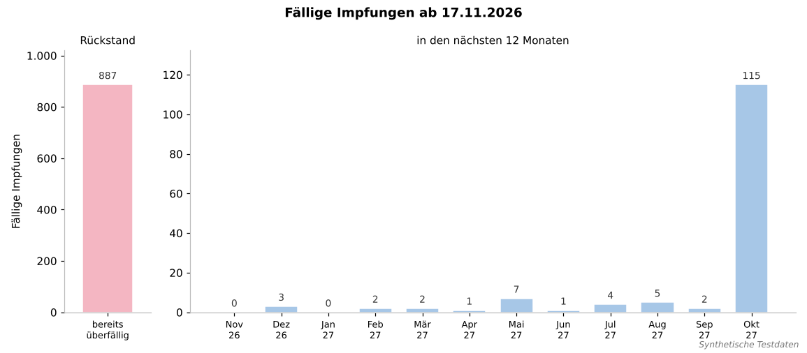
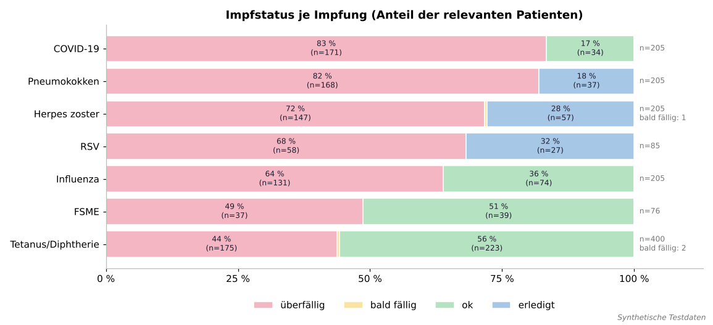
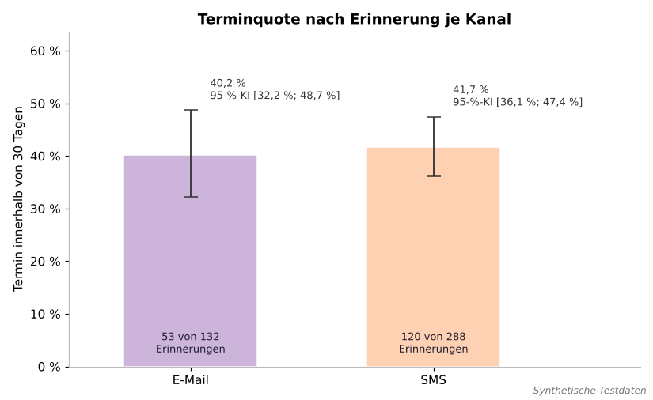
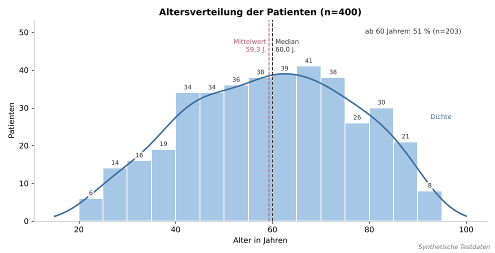

# 💉 Vaccination Reminder · Impf-Erinnerung



**▶ [Live app](https://impf-erinnerung.streamlit.app) · [30-second demo](https://impf-erinnerung.streamlit.app/?demo=1) · [English](#english) · [Deutsch](#deutsch)**

> All data is **synthetic**, sending is **simulated**. The vaccination rules are a simplified
> implementation of the German STIKO recommendations and must be reviewed by a physician
> before any real use. · Alle Daten sind synthetisch, der Versand ist simuliert.

---

## English

A portfolio prototype for a general practice: the app detects when patients need a booster,
shows a **pop-up** to the practice team and sends a **reminder by text message or email**
(simulated here). An analysis page shows the backlog, vaccination gaps and how well reminders
turn into appointments. The interface is available in English and German.

### Features

| Area | What happens |
|---|---|
| **Daily overview (pop-up)** | On opening: number of overdue and soon-due vaccinations, next due dates, “remind all” button |
| **Open patient (pop-up)** | Selecting a patient shows their due vaccinations and a preview of the message |
| **Due vaccinations** | Filter by vaccine and status, bulk sending |
| **Sending log** | Every reminder with channel, recipient, text and timestamp |
| **Analysis** | 4 charts, each with a key finding |
| **Rules** | Rule table with source and date |

**Safeguards:** no message without consent · no second reminder for the same vaccine within
90 days · message text contains no diagnoses. Patient messages are sent in German, because
the practice is located in Germany.

### Rules (`data/impfregeln.csv`)

| Vaccine | From age | Rule |
|---|---|---|
| Tetanus/diphtheria | 18 | every 10 years, next one once as Tdap |
| Influenza | 60 | yearly from 1 October |
| COVID-19 | 60 | yearly from 1 October |
| Pneumococcal | 60 | once |
| Herpes zoster (shingles) | 60 | 2 doses, 2–6 months apart |
| RSV | 75 | once |
| TBE (tick-borne encephalitis) | only if indicated | every 5 years, every 3 years from 60 (simplified) |

### Analysis






### Tech stack

Python · Streamlit (`st.dialog` pop-ups) · SQLite with SQL CTEs · pandas · matplotlib/SciPy ·
pytest. A real SMS or email provider can be plugged in by writing a class with
`senden(kanal, empfaenger, text)` and passing it to `versende_erinnerungen`.

---

## Deutsch

Portfolio-Prototyp für eine Hausarztpraxis: Das Tool erkennt, wann Patientinnen und Patienten
eine Auffrischimpfung brauchen, zeigt dem Praxisteam ein **Popup** und verschickt eine
**Erinnerung per SMS oder E-Mail** (hier simuliert). Eine Analyse-Seite zeigt Rückstand,
Impflücken und wie gut Erinnerungen zu Terminen führen. Die Oberfläche gibt es auf Deutsch
und Englisch.

### Funktionen

| Bereich | Was passiert |
|---|---|
| **Tagesübersicht (Popup)** | Beim Öffnen: überfällige und bald fällige Impfungen, nächste Fälligkeiten, Button „Alle erinnern“ |
| **Patient aufrufen (Popup)** | Bei Auswahl eines Patienten: seine fälligen Impfungen und eine Vorschau der Nachricht |
| **Fällige Impfungen** | Filter nach Impfung und Status, Sammelversand |
| **Versandprotokoll** | Jede Erinnerung mit Kanal, Empfänger, Text und Zeitpunkt |
| **Analyse** | 4 Diagramme mit Aussagesatz |
| **Regeln** | Regeltabelle mit Quelle und Stand |

**Schutzmechanismen:** keine Nachricht ohne Einwilligung · keine zweite Erinnerung zur selben
Impfung innerhalb von 90 Tagen · Nachrichtentext ohne Diagnosen.

### Impfregeln (`data/impfregeln.csv`)

| Impfung | ab Alter | Regel |
|---|---|---|
| Tetanus/Diphtherie | 18 | alle 10 Jahre, nächste einmalig als Tdap |
| Influenza | 60 | jährlich ab 1. Oktober |
| COVID-19 | 60 | jährlich ab 1. Oktober |
| Pneumokokken | 60 | einmalig |
| Herpes zoster | 60 | 2 Dosen im Abstand von 2–6 Monaten |
| RSV | 75 | einmalig |
| FSME | nur bei Indikation | alle 5 Jahre, ab 60 alle 3 Jahre (vereinfacht) |

### Analyse






---

## Project structure · Aufbau

```
app.py                  Streamlit app with pop-ups, language switch DE/EN
src/core.py             rules, due-date logic, SQLite, sending interface
src/i18n.py             translations and number formats (DE: 47,5 % · EN: 47.5%)
src/charts.py           charts (pastel colours, values labelled)
src/testdaten.py        synthetic patients, vaccinations, reminders, appointments
src/vorschau.py         renders the charts to vorschau/de and vorschau/en
sql/                    appointment-rate query and sample queries (CTEs)
data/impfregeln.csv     rule table – editable without code
tests/                  22 tests: rules, sending, SQL, translations
ENTSCHEIDUNGEN.md       design decisions (in German)
```

## Run locally · Lokal starten

```bash
pip install -r requirements.txt
streamlit run app.py          # creates data/praxis.db with 400 synthetic patients on first start
pytest -q
```

## Not covered yet · Für einen echten Einsatz fehlt noch

- Connection to the practice management system (export, GDT or vendor API)
- Consent management and data-protection review (GDPR Art. 9, processing agreement with the SMS/email provider)
- Medical review of the rules, e.g. risk groups and vaccine-specific intervals
